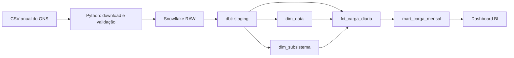

# Carga de energia no Brasil | ONS → Snowflake

Pipeline de engenharia de dados para transformar a **carga diária por subsistema** do ONS em um esquema estrela pronto para análise. A ideia é responder perguntas simples com dados confiáveis: como a carga evolui, quais subsistemas mais contribuem e como os meses se comparam.

## O que o projeto entrega

**Grão da fato:** um dia × um subsistema. `fct_carga_diaria` guarda a carga em **MWmed** e se relaciona com `dim_data` e `dim_subsistema`. `mart_carga_mensal` expõe a **média** das cargas diárias do mês; somar MWmed ao longo dos dias produziria um indicador sem interpretação correta.

O fluxo carrega anos a partir de 2024. Essa escolha evita comparar diretamente períodos anteriores com definições diferentes: o [ONS registra mudanças metodológicas em 2021 e 2023](https://dados.ons.org.br/dataset/carga-energia). O ONS também pode revisar dias já publicados. Por isso, cada execução salva o arquivo recebido com seu hash e faz `MERGE` pela chave dia + subsistema no Snowflake.

**Estado verificado em 22/10/2026:** os CSVs de 2024 a 2026 passaram pela validação Python. No Snowflake, a carga inicial por SQL produziu 4.096 linhas na RAW, 1.024 dias, 4 subsistemas, 4.096 linhas na fato e 136 linhas no mart mensal. A consulta de qualidade não encontrou dias incompletos nem chaves duplicadas. O projeto dbt passou em `dbt parse`; a DAG ainda não foi executada.

## Qualidade

- Na ingestão: esquema do CSV, UTF-8, quatro subsistemas por dia, datas contínuas, chave única e carga positiva.
- No dbt: chaves únicas nas dimensões, relacionamentos da fato, grão diário e carga positiva.
- Na automação: testes Python no GitHub Actions; o Airflow só constrói os modelos depois de uma carga bem-sucedida.

Para conferir o resultado completo no Snowflake, execute [`sql/quality_audit.sql`](sql/quality_audit.sql). Os indicadores de erro devem ser zero.

## Executar

1. Execute [`sql/bootstrap.sql`](sql/bootstrap.sql) no Snowflake. Ele cria um warehouse **X-Small** com suspensão automática após 60 segundos, o banco e os schemas.
2. Copie `.env.example` para `.env` e preencha conta, usuário, role e PAT do Snowflake. Use uma role com acesso só aos objetos do projeto. Nunca publique `.env` ou um token.
3. Para validar um CSV local sem conectar ao Snowflake: `python -m ons_carga.ingest --years 2026 --file caminho/para/CARGA_ENERGIA_2026.csv --dry-run` (com `PYTHONPATH=src`).
4. Com WSL 2 e Docker Desktop disponíveis no Windows, use `docker compose up --build -d`. O painel do Airflow ficará em `http://localhost:8080`. O usuário é `admin`; a senha gerada fica em `config/simple_auth_manager_passwords.json.generated`.

A DAG `ons_carga_diaria` roda às **22h, horário de São Paulo**, carrega os anos configurados e executa `dbt build`. O [ONS publica os arquivos em CSV com licença CC BY](https://dados.ons.org.br/dataset/carga-energia); a fonte deve ser creditada ao usar os dados em dashboards.

## Estrutura

| Pasta | Conteúdo |
| --- | --- |
| `src/ons_carga/` | download, validação, snapshot e carga incremental |
| `dags/` | orquestração no Airflow |
| `dbt/models/` | staging, dimensões, fato e mart mensal |
| `dbt/tests/` e `tests/` | regras SQL e testes Python |
| `sql/` | configuração inicial do Snowflake e exemplos para BI |

**Fonte:** [ONS Dados Abertos · Carga de Energia Diária](https://dados.ons.org.br/dataset/carga-energia). Dados em MWmed por subsistema, sujeitos a revisão na origem.

